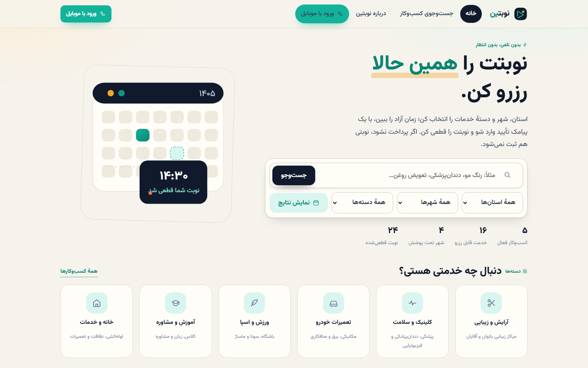
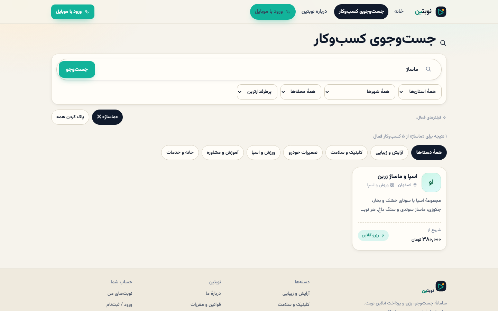
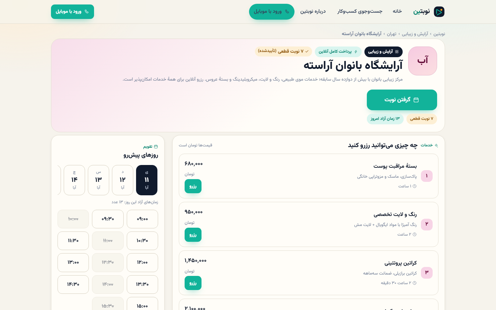
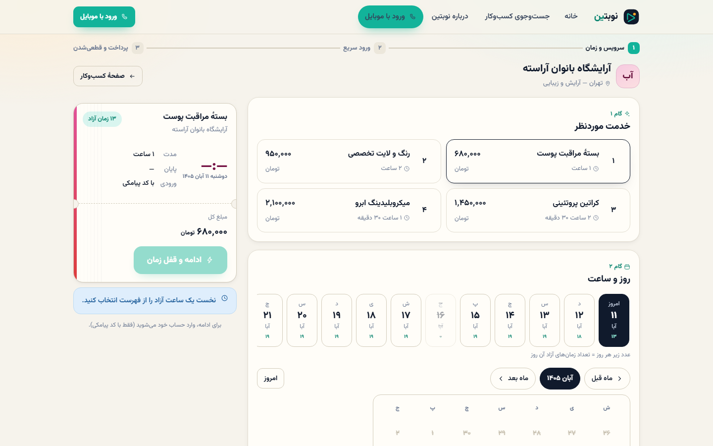
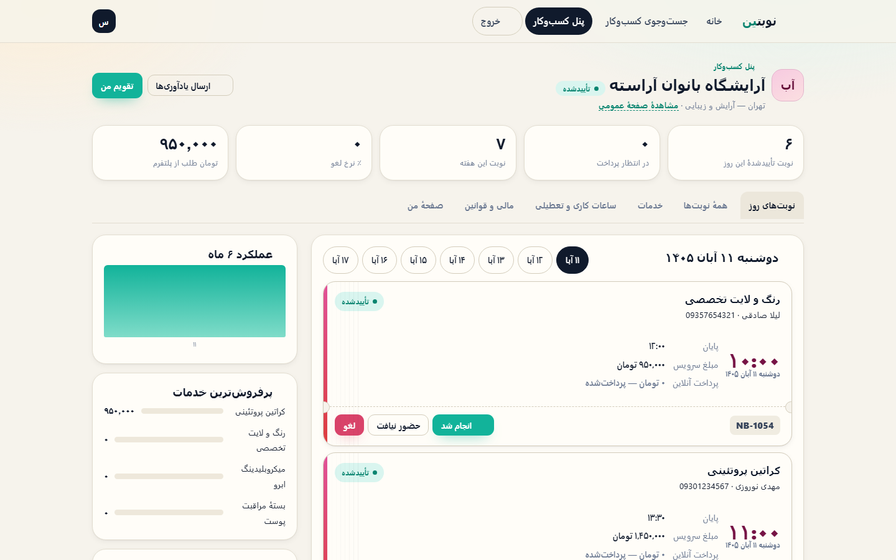
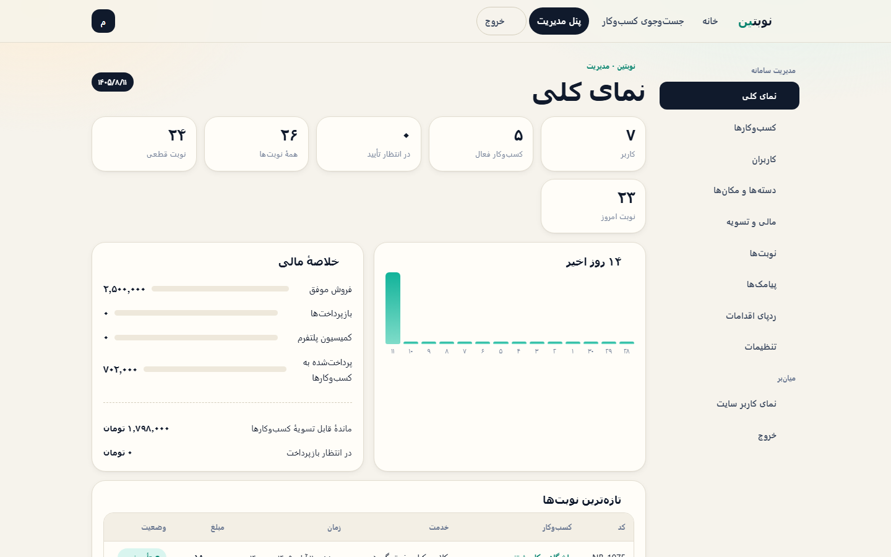
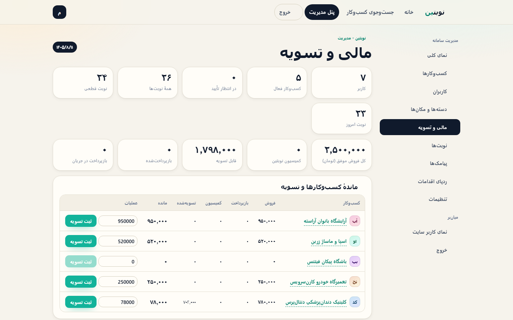
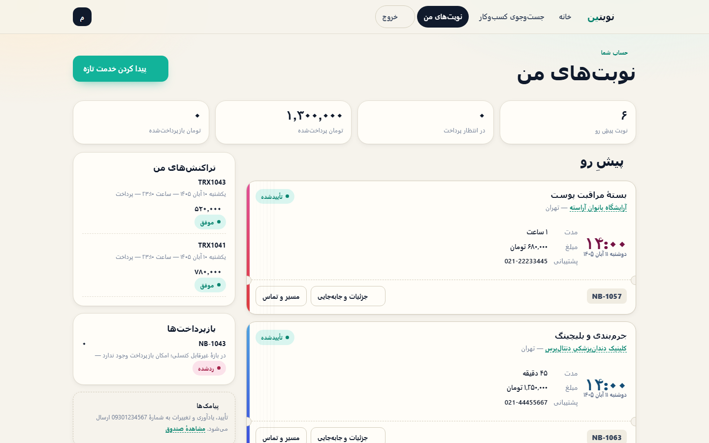
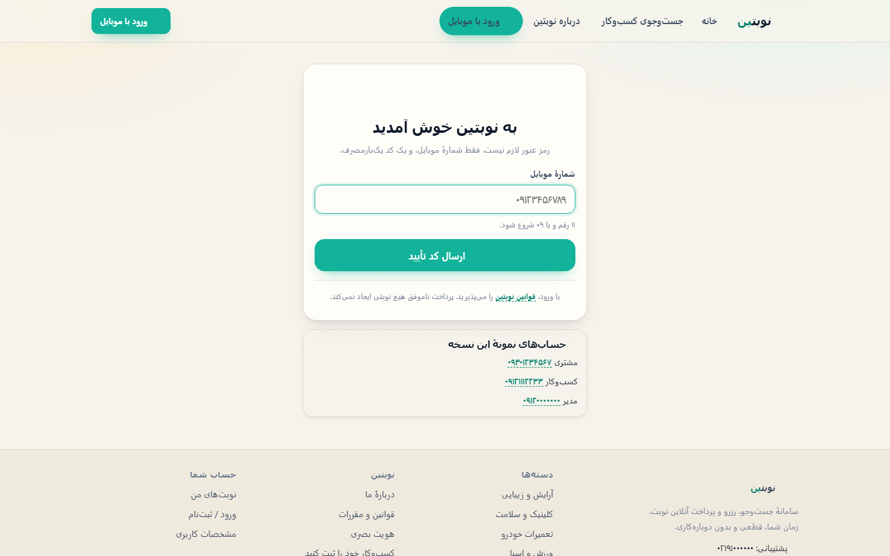
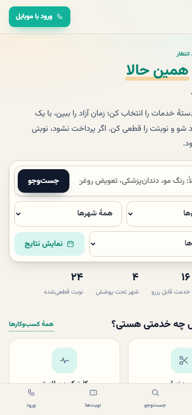

# نوبتین — سامانهٔ نوبت‌دهی آنلاین


نوبتین یک سامانهٔ سبک و سریعِ نوبت‌دهی آنلاین است: مشتری کسب‌وکار را جست‌وجو می‌کند، از
تقویم شمسی زمان آزاد را برمی‌گزیند، با شمارهٔ موبایل و کد یک‌بارمصرف وارد می‌شود، پرداخت
کامل یا پیش‌پرداخت انجام می‌دهد و پیامک تأیید می‌گیرد. کسب‌وکار نوبت‌ها، ساعات کاری، خدمات،
قوانین کنسلی و مالی خودش را می‌بیند و مدیر بر کل سامانه، کاربران، دسته‌بندی‌ها، مالی و
تسویه نظارت دارد.

فناوری: **Flask + SQLite + Jinja** — بدون React، بدون Node، بدون CDN. فونت وزیرمتن و همهٔ
آیکون‌ها داخل پروژه‌اند. کل رابط راست‌به‌چپ و موبایل‌اول است.

---

### English — TL;DR

**Nobatin** is a lightweight online appointment system for Iranian small businesses. A customer
searches a business, picks a free slot on a Jalali (Persian) calendar, signs in with a mobile
number and a one-time code, pays in full or only a deposit, and gets an SMS confirmation. Each
business gets its own panel — appointments, working hours, services, cancellation rules, balance
and settlements — and an admin supervises users, businesses, categories, regions, money flow and
payouts.

Stack: **Flask + SQLite + Jinja**, server-rendered, right-to-left, mobile-first. There is no
build step, no Node, no CDN and no SPA; the font and every icon ship inside the repository. The
whole thing runs with `pip install -r requirements.txt && python app.py`.

Two integrations are **deliberately simulated** in this review build, and both are single-file
swap points: the bank **payment gateway** (`core/gateway.py` renders a sandbox result page) and
**SMS delivery** (messages are written to the `sms_log` table instead of an operator). Everything
around them is real and tested: a failed payment never confirms a booking, refunds are independent
auditable rows, cancellation rules are snapshotted per appointment, concurrent bookings for one
slot are resolved by a transactional lock, and each business can only ever see its own data.

Read [docs/ARCHITECTURE.md](docs/ARCHITECTURE.md) for the diagrams, [CONTRIBUTING.md](CONTRIBUTING.md)
to run the tests, and [SECURITY.md](SECURITY.md) before reporting anything security-related.

---

## صفحه‌ها (اسکرین‌شات از خودِ برنامه)

همهٔ تصویرها از اجرای واقعی همین مخزن گرفته شده‌اند (دادهٔ نمونهٔ داخل مخزن). نسخهٔ تمام‌اندازه
در پوشهٔ [`docs/screenshots/`](docs/screenshots) است.

<table>
  <tr>
    <td width="50%"></td>
    <td width="50%"></td>
  </tr>
  <tr>
    <td align="center">صفحهٔ اصلی + جست‌وجو و فیلتر آب‌وهوایی</td>
    <td align="center">نتیجهٔ جست‌وجو با برچسب فیلترهای فعال</td>
  </tr>
  <tr>
    <td></td>
    <td></td>
  </tr>
  <tr>
    <td align="center">صفحهٔ اختصاصی کسب‌وکار: خدمات، ساعات، قوانین</td>
    <td align="center">تقویم شمسی، زمان‌های آزاد و سبد نوبت</td>
  </tr>
  <tr>
    <td></td>
    <td></td>
  </tr>
  <tr>
    <td align="center">پنل کسب‌وکار: نوبت‌های امروز و مدیریت خدمات</td>
    <td align="center">پنل مدیریت: نمای کلی سامانه</td>
  </tr>
  <tr>
    <td></td>
    <td></td>
  </tr>
  <tr>
    <td align="center">مالی: تراکنش‌ها، کارمزد، مانده و تسویه</td>
    <td align="center">پنل مشتری: نوبت‌ها، لغو و پرداخت دوباره</td>
  </tr>
  <tr>
    <td></td>
    <td></td>
  </tr>
  <tr>
    <td align="center">ورود با موبایل + OTP (کد در پیامکِ خودِ سامانه)</td>
    <td align="center">رابط موبایل‌اول در ۳۹۰px بدون سرریز افقی</td>
  </tr>
</table>

سه تصویر دیگر در همان پوشه‌اند: `11-rules.png` (قوانین کنسلی پنل کسب‌وکار)،
`12-appointments.png` (فهرست نوبت‌ها در پنل مدیریت) و `14-sms.png` (صندوق پیامکِ کاربر).

---

## فهرست

مخزن روی گیت‌هاب یک فهرست کناری خودکار دارد؛ این هم ترتیب بخش‌ها:

۱. سریع‌ترین راه اجرا
۲. اجرای جدی (production) — کنترل‌های fail-closed
۲-ب. بردن روی سرور (لینوکس) — `deploy/`، همزمانی، سرصفحه‌ها و عددهای سنجهٔ بار
۳. چیزی که خواسته شده بود ↔ جایی که پیاده شده
۳-ب. پیاده‌شده ↔ عمداً شبیه‌سازی‌شده
۴. پیامک: چه زمانی، به چه کسی
۵. امنیت ورود · ۵-ب CSRF و ردپای اقدامات · ۵-پ نام محله‌ها
۶. پرداخت و پول
۷. ساختار پروژه
۸. نکات و کارهای باقی‌مانده

فایل‌های بازبینی: [CONTRIBUTING.md](CONTRIBUTING.md) (اجرا + آزمون + ثابت‌ها) ·
[SECURITY.md](SECURITY.md) (گزارش امنیتی) · [CHANGELOG.md](CHANGELOG.md) ·
[LICENSE](LICENSE) (مالکیت خصوصی، فقط بازبینی) · [docs/ARCHITECTURE.md](docs/ARCHITECTURE.md)
(چهار دیاگرام: نمای کلی، لایهٔ WSGI، توالی رزرو/پرداخت، موجودیت‌ها) ·
[.github/workflows/ci.yml](.github/workflows/ci.yml) (سه شغل: آزمون، بوت production، بهداشت مخزن) ·
[docs/github-guide.pdf](docs/github-guide.pdf) (راهنمای مرحله‌به‌مرحلهٔ انتشار)

---

## ۱) سریع‌ترین راه اجرا

```bash
pip install -r requirements.txt
python app.py                 # → http://127.0.0.1:5077
```

بار اول، دیتابیس `instance/nobatin.db` ساخته و با دادهٔ نمونه پر می‌شود
(۵ کسب‌وکار، ۷ کاربر، دسته‌بندی/استان/شهر/محله، ساعات کاری و قوانین کنسلی).

حساب‌های نمونه:

| نقش        | موبایل      | پنل        |
|------------|-------------|------------|
| مدیر       | 09120000000 | `/modiriat`|
| کسب‌وکار   | 09121112233 | `/kasbkar` |
| مشتری      | 09301234567 | `/pankack` |

در حالت توسعه کد ورود برای همهٔ شماره‌ها ثابت است: **۱۲۳۴۵**. هر شمارهٔ تازه، خودش
«مشتری» ساخته می‌شود و اگر شمارهٔ یک کسب‌وکار تأییدنشده باشد، وارد پنل کسب‌وکار می‌شود.

**ثبت کسب‌وکار توسط خودِ کاربر:** پیوند «کسب‌وکار خود را ثبت کنید» (پابرگ و منوی حساب)
برای هر کاربر واردشده باز است؛ فرم `/kasbkar/new` را می‌بیند و پس از ثبت، نقشش از
«مشتری» به «کسب‌وکار» عوض می‌شود (این تبدیل در ردپای اقدامات با اقدام
`user_become_business` ثبت می‌گردد) و پنل `/kasbkar` باز می‌شود. کسب‌وکار در حالت
«در انتظار تأیید مدیر» می‌ماند تا مدیر آن را فعال کند. نقش مدیر با ثبت کسب‌وکار
تغییر نمی‌کند، و هیچ‌کس به پنل کسب‌وکارِ دیگری دسترسی پیدا نمی‌کند (۴۰۳).

دستورهای دیگر:

```bash
python app.py --reset            # ساخت دوبارهٔ دادهٔ نمونه (دیتابیس فعلی پاک می‌شود)
python app.py --send-reminders   # ارسال یادآوری‌های معوق و خروج (مناسب cron)
python app.py --expiry           # آزادسازی سبدها و نوبت‌های بی‌زمان (مناسب cron)
python app.py --help
python smoke_test.py             # ۳۵ بخش / ۵۱۵ فراخوانی بررسی، روی دیتابیس جدا (خروج ۰ = همه پاس)
```

## ۲) اجرای جدی (production)

```bash
# کلید رمز را یک‌بار بسازید و ذخیره کنید:
python -c "import secrets; print(secrets.token_urlsafe(48))"

set NOBATIN_SECRET=<کلید>        # Windows   (Linux/mac: export NOBATIN_SECRET=...)
python wsgi.py                   # waitress روی 127.0.0.1:8080 (پیش‌فرض loopback)
# یا: waitress-serve --host 127.0.0.1 --port 8080 wsgi:app
```

`wsgi.py` پیش‌فرض روی محیط `production` است و **عمداً fail-closed** عمل می‌کند:

* بدون `NOBATIN_SECRET` برنامه بالا نمی‌آید.
* اگر `NOBATIN_OTP_MASTER=1` باشد (کد ثابت ۱۲۳۴۵ برای هر شماره) برنامه بالا نمی‌آید.
* اگر `NOBATIN_TRUSTED_HOSTS` خالی باشد برنامه بالا نمی‌آید — بی آن هر سرصفحهٔ Host
  باور می‌شود و پیوندِ پیامکی می‌تواند به دامنهٔ مهاجم برود.
* اگر درگاه روی `sandbox` باشد و `NOBATIN_ALLOW_SANDBOX=1` نگذاشته باشید، برنامه بالا
  نمی‌آید: درگاه آزمایشی یعنی هر کاربرِ واردشده می‌تواند «پرداخت موفق» بزند و نوبت را
  بدون پول قطعی کند. برای سرور نمایشی همان یک متغیر را صریحاً ۱ بگذارید.
* در production پیش‌فرض‌ها روشن‌اند: `NOBATIN_COOKIE_SECURE=1`، HSTS، و
  `NOBATIN_SMS_MASK_OTP=1` — آن آخری رقم‌های کد ورود را در `sms_log` و پنل پیامک‌ها
  ذخیره نمی‌کند (به اپراتور همان متن کامل می‌رود).
* نشانی پیش‌فرض اجرا `127.0.0.1` است (`NOBATIN_HOST=0.0.0.0` عمداً باید بنویسید)؛
  این برنامه برای پشتِ پروکسیِ TLS نوشته شده، نه روبه‌روی اینترنت.
* کد یک‌بارمصرف تصادفی است و محدودیت نرخ دارد (بخش ۴).
* هر درخواست نوشتن (POST/PUT/PATCH/DELETE) بدون توکن CSRF رد می‌شود؛ برای nginx هم
  `NOBATIN_BEHIND_PROXY=1` را روشن کنید تا سقف‌های IP با IP واقعی کار کنند (بخش ۵-ب و ۸).

همهٔ متغیرهای محیطی در `.env.example` توضیح داده شده‌اند. آن فایل به‌طور خودکار خوانده
نمی‌شود؛ متغیرها را در shell یا سرویس‌دهنده (systemd/supervisor/Docker/IIS) تنظیم کنید.

## ۲-ب) بردن روی سرور (لینوکس)

بستهٔ آماده در پوشهٔ `deploy/` است و راهنمای گام‌به‌گام خودش را دارد
(`deploy/README.md`): `nobatin.service` (gunicorn با ۳ worker و `ProtectSystem=strict`)،
`nginx-nobatin.conf` (TLS، gzip، کش ایستا، سقف حجم بدنه، بستن `/healthz`)،
چهار `timer` برای انقضا/یادآوری/نگهداری/پشتیبان، و `backup.sh` + `restore.sh`
(نسخه‌برداری آنلاین SQLite با تأیید `PRAGMA integrity_check`).

چیزی که برای «چند کاربر هم‌زمان» ساخته شده و در آزمون اثبات شده است:

* **یک ساعت، یک برنده:** قفل ساعت و ساخت نوبت هر دو داخل `BEGIN IMMEDIATE` و با
  قید یکتای جزئی (`ux_appt_slot_active`) انجام می‌شود؛ هشت درخواست هم‌زمان روی یک
  ساعت = یک نوبت، بقیه پیام «هم‌زمان رزرو شد» (بخش ۳۳ آزمون).
* **پرداخت دوباره‌ای ثبت نمی‌شود:** `finalize_payment` با `UPDATE … WHERE status<>…`
  و بررسی `rowcount` idempotent است؛ شش بازگشت هم‌زمان درگاه = یک نوبت قطعی، یک
  تراکنش موفق، یک پیامک.
* **لغو و بازپرداخت هم اتمیک:** شش لغوی هم‌زمان روی یک نوبت = یک «لغو شد» و حداکثر یک
  رکورد بازپرداخت؛ لغوِ نوبتِ «در انتظار پرداخت» دیگر در تاریخچه «منقضی» ثبت نمی‌شود و
  پیامکِ «پرداخت ناموفق» برای مشتریِ خودش‌لغوکرده نمی‌رود (بخش ۳۵ آزمون).
* **جابه‌جایی ساعت:** قفلِ تازه، آزادکردن قفلِ کهنه (حتی وقتی وضعیتش `booked` است)،
  خودِ نوبت و ارتقای قفل هر چهار نوشتن یک تراکنش‌اند؛ ساعتِ قبلی همان لحظه در تقویم
  دوباره خالی می‌شود، و ساعتِ اشغال‌شده یا «۲۵:۷۱» نوبت را خراب نمی‌کند.
* **سقف نرخ سراسری:** شمارنده روی جدول `rate_events` است، پس بین workerها هم مشترک
  می‌ماند و با `UPSERT … RETURNING` زیر بار هم دقیق شمارش می‌کند.
* **پیامک بعد از commit:** نوشتن دیتابیس و تماس بیرونی هم‌زمان قفل نمی‌گیرند.
* **کش و اثر انگشت فایل‌های ایستا:** فهرست دسته/استان/شهر ۱۵ ثانیه کش می‌شود و با
  هر نوشتن روی همان جدول‌ها بی‌اعتبار می‌گردد؛ `?v=<hash>` روی CSS/JS یعنی کش
  یک‌سالهٔ بی‌خطر.
* `/healthz` (از loopback یا با توکن) و `python app.py --selfcheck` که روی سرور
  می‌گوید کدام تنظیم هنوز آمادهٔ production نیست.
* **گارد هدر Host در لایهٔ WSGI:** فقط دامنه‌های `NOBATIN_TRUSTED_HOSTS` پذیرفته
  می‌شوند (با همان قاعدهٔ werkzeug؛ «`.example.com`» یعنی زیردامنه‌ها هم مجاز).
  مقدار قبل از ورود به Flask نرمال می‌شود (بزرگی/کوچکی، نقطهٔ انتهایی، پورت)، پس
  `X-Forwarded-Host` جعلی هم نمی‌تواند پیوندها و پیامک‌ها را به دامنهٔ مهاجم بسازد؛
  پاسخ رد هم ۴۰۰ ساده است، نه ۵۰۰ با پشتهٔ خطا.
* **IP واقعی بدون شکستن `/healthz`:** لایهٔ `peer_stamp` پیش از `ProxyFix` نشانیِ
  واقعیِ سوکت را در `environ["nobatin.peer_addr"]` نگه می‌دارد و `/healthz` فقط به همان
  نگاه می‌کند؛ به همین دلیل در `deploy/nginx-nobatin.conf` عمداً `set_real_ip_from`
  ننوشته‌ایم — اگر nginx خودِ `X-Forwarded-For` را جای `remote_addr` بنشاند، همان
  سرصفحهٔ جعلی می‌تواند «از loopback» وانمود کند. در کنارش
  `proxy_set_header X-Forwarded-Prefix ""` هم گذاشته شده تا سرصفحهٔ ارسالیِ مرورگر در
  پیوندها و لینکِ پیامکی اثر نگذارد.
* **سرصفحه‌ها:** CSP بدون اسکریپت درون‌خطی (همهٔ قالب‌ها پاک‌سازی شدند)،
  `X-Frame-Options: DENY`، `nosniff`، `Referrer-Policy`، `Permissions-Policy`،
  `Server: nobatin`، HSTS فقط در production، و `no-store` + `Vary: Cookie` روی پنل‌ها.

**سنجهٔ بار** (`python tools/bench.py`؛ شرح خروجی و آستانه‌ها در همان فایل است). همهٔ عددها روی
**همین ماشینِ توسعه**، سرور تک‌پروسه و بدون TLS گرفته شده‌اند و در عمل دو–سه بار تکرار شده‌اند؛
ماشین توسعه کم‌هسته است، پس اینها کفِ محافظه‌کارانه‌اند نه سقف. هیچ‌کدام از اجراها خطا و پاسخ ۵xx
نداشته‌اند.

| سناریو                                  | ترد | RPS        | p95 (ms)     |
|-----------------------------------------|----:|-----------:|-------------:|
| صفحه‌های عمومی (۲۹ مهر، دو تکرار)        | ۸ | ۱۴۰ – ۱۶۴ | ۱۴۰ – ۱۷۰   |
| پنل واردشده                             | ۸ | ۹۰ – ۹۸   | ۱۴۰ – ۱۶۵   |
| خانه + جست‌وجو (دوباره‌سنجی ۳۰ مهر)      | ۱۶ | ۱۱۵       | ۲۱۴ (p99 ۲۵۲) |
| خانه + جست‌وجو                           | ۳۲ | ۱۰۳       | ۴۶۷          |
| `wsgi.py` با `NOBATIN_ENV=production`، دیتابیس جدا و **خالی** | ۱۶ | ۳۲۹ | ۷۴         |
| اجرای production، ۱۶ مشتری هم‌زمان       | ۸ | ≈ ۳۷۲     | ۸۴           |
| همان، ترد بیشتر                          | ۱۶ | یکسان     | ۱۲۳          |

دو نتیجهٔ عملی:

* با ۳۲ ترد، RPSِ خانه می‌افتد و p95 تا ۴۶۷ میلی‌ثانیه بالا می‌رود — روی این ماشین ترد بیشتر
  فقط صف را بلند می‌کند. `NOBATIN_THREADS` همان ۸ بماند و اگر لاگِ waitress هشدار
  «Task queue depth» داد، **worker** اضافه کنید نه ترد.
* عدد ۳۲۹ RPS روی دیتابیس خالی است؛ ملاک، همان ۱۴۰–۱۶۵ ردیفِ با دادهٔ نمونه است.

در همان اجرای production صفت‌های کوکی `Secure; HttpOnly; SameSite=Lax` دیده شد، HSTS و CSP
فرستاده شد، `Host: evil.com` پاسخ ۴۰۰ گرفت و `/healthz` با `X-Forwarded-For` جعلی از بیرون
۴۰۴ ماند (معیار، نشانیِ سوکت است).

## ۳) چیزی که خواسته شده بود ↔ جایی که پیاده شده

| نیاز                       | کجا                                                                 |
|----------------------------|----------------------------------------------------------------------|
| صفحهٔ اصلی، جست‌وجو، دسته   | `routes/public.py`، `templates/home.html`، `search.html`، `category.html` — جست‌وجو با `core/jalali.py: like_pattern` یک‌شکل می‌شود: ي/ک عربی = فارسی، «کسب وکار» با فاصله = «کسب‌وکار» با نیم‌فاصله، و `%`/`_` کاربر فرار می‌کند |
| انتخاب استان/شهر/حوزهٔ کاری| فیلترهای `do_search` + `provinces/cities/districts`؛ آب‌وهوایی (استان←شهر←محله با `static/js/filters.js`) و برچسبِ فیلترهای فعال با ✕ برداشتنی |
| تبلیغ ثبت کسب‌وکار          | انتهای `templates/home.html` (بنر `.promo` در `static/css/nobatin.css`)؛ دکمه بر اساس نقش بازدیدکننده مقصد درست می‌دهد: مهمان ← `/vorood?next=/kasbkar/new`، مشتری ← فرم ثبت، مالک ← پنل کسب‌وکار خودش. ادعاها فقط قابلیت‌های پیاده‌شده‌اند (تأییدِ این‌ها در بخش ۳۲ `smoke_test.py`) و عدد کمیسیون از تنظیمات واقعی پلتفرم خوانده می‌شود |
| صفحهٔ اختصاصی کسب‌وکار      | `/k/<slug>` → `templates/business.html` (خدمات، ساعات، قوانین، نوبت‌های فروش‌رفته، مشابه‌ها) |
| خدمات، قیمت، مدت، شرایط    | تب «خدمات» پنل کسب‌وکار → `save_service` (قیمت، مدت، فاصلهٔ بین نوبت، فعال/غیرفعال) |
| تقویم شمسی و زمان‌های آزاد  | `core/jalali.py`، `booking.month_availability` و `slot_times`         |
| جلوگیری از رزرو هم‌زمان     | جدول `slot_locks` + `hold_slot` با `BEGIN IMMEDIATE` + نمای یکتای مشروط روی نوبت‌های زندهٔ همان ساعت |
| ورود با موبایل و کد یک‌بارمصرف | `routes/auth.py` + `core/db.py: create_otp/verify_otp/otp_throttle` |
| پرداخت کامل یا پیش‌پرداخت   | `payment_mode` سه حالت `full / deposit / free`؛ مبلغ قابل‌پرداخت در `payable_now` |
| ثبت و پیگیری تراکنش‌ها      | جدول `transactions` (مرجع یکتا، درگاه، trace، وضعیت، زمان) + تب «مالی» مدیریت |
| پرداخت ناموفق = نوبت قطعی نه | `mark_payment_failed`؛ آزمون بخش ۸ و ۲۵                             |
| قوانین لغو پلکانی و بازپرداخت | `cancel_policy` JSON + `evaluate_cancellation`؛ سیاست روی هر نوبت **کپی ثابت (snapshot)** می‌شود |
| پیامک تأیید/یادآوری/تغییرات | `core/db.py: send_sms` + ۱۲ قالب؛ لاگ کامل در `sms_log` (بخش ۴)      |
| پنل مشتری                  | `/pankack`، `/nobat/<id>`: جزئیات، لغو با پیش‌نمایش بازپرداخت، جابه‌جایی، پرداخت دوباره |
| پنل کسب‌وکار               | `/kasbkar/new` (ثبت خودکار کاربر و تبدیل نقش به `business`) و `/kasbkar/<slug>`: امروز، خدمات، ساعات کاری، تعطیلی روز، قوانین، نمای کلی، مالی، پیامک‌ها — ساعات پیش‌فرض هر ۷ روز (شنبه تا جمعه) ساخته می‌شود |
| پنل مدیریت                 | `/modiriat`: کاربران، کسب‌وکارها، دسته‌بندی‌ها/مکان‌ها، مالی، نوبت‌ها، پیامک، ردپای اقدامات، تنظیمات |
| گزارش مالی و تسویه         | `finance_totals`، `business_balance`، جدول `settlements` + دفتر کل تراکنش‌ها |
| جداسازی دادهٔ هر کسب‌وکار   | `can_manage_biz` / `require_login(role)`؛ هر کوئری پنل با `business_id` مالک غربال می‌شود |
| ضد CSRF                     | `core/csrf.py` + `app.py: guard_csrf`؛ `{{ csrf() }}` در همهٔ فرم‌های POST (بخش ۵-ب) |
| ردپای عملیات حساس           | جدول `audit_log` + `core/helpers.py: audit()`؛ تب «ردپای اقدامات» در پنل مدیریت |
| محلهٔ تکراری / غلط‌املایی    | کلید `norm` + `ux_districts_city_norm` + `migrate_places`؛ مدیریت محله در پنل (بخش ۵-پ) |

## ۳-ب) پیاده‌شده ↔ عمداً شبیه‌سازی‌شده

شفاف‌سازی برای بازبینی: هر چه در جدول بالا هست واقعی و در آزمون پوشش داده شده است. تنها **دو**
چیز در این نسخهٔ بازبینی شبیه‌سازی‌اند — و هر دو عمداً، چون به قرارداد بانکی و خط سرویس
پیامک نیاز دارند:

| بخش                       | وضعیت                | نقطهٔ تعویض به سرویس واقعی                                                                                                |
|---------------------------|----------------------|---------------------------------------------------------------------------------------------------------------------------|
| درگاه بانک                | `sandbox` (شبیه‌سازی) | فقط `core/gateway.py` (ساخت درخواست + هدایت به بانک + `verify`) و صفحهٔ `routes/gateway.py`. جدول `transactions`، وضعیت‌ها (`created/pending/success/failed/cancelled`) و جریان نوبت دست‌نخورده می‌ماند |
| فرستندهٔ پیامک            | `log` (شبیه‌سازی)     | فقط `core/db.py: _dispatch`. برای کاوه‌نگار: `NOBATIN_SMS_PROVIDER=kavenegar` + `KAVENEGAR_KEY` + `KAVENEGAR_SENDER`         |
| TLS                       | بیرون از اپ           | nginx (`deploy/nginx-nobatin.conf`)؛ اپ روی `127.0.0.1` می‌نشیند و با `NOBATIN_BEHIND_PROXY=1` IP/پروتکل واقعی را می‌خواند |

هر چیز دیگری — تقویم شمسی، قفل همزمانی ساعت، OTP و سقف نرخ آن، CSRF، ردپا، جداسازی دادهٔ
کسب‌وکار، قوانین کنسلی پلکانی، رکوردهای بازپرداخت، تسویه، کارمزد، پشتیبان‌گیری، سنجهٔ بار و
۳۵ بخش آزمون — واقعی است و با `python smoke_test.py` سنجیده می‌شود.

> درگاه آزمایشی را نمی‌توان «حالتی» گذاشت و فراموش کرد: `wsgi.py` در production با درگاه
> `sandbox` بدون `NOBATIN_ALLOW_SANDBOX=1` **بالا نمی‌آید**، چون در آن حالت هر کاربر واردشده
> می‌تواند «پرداخت موفق» بزند و نوبت را بی‌پول قطعی کند.

## ۴) پیامک: چه زمانی، به چه کسی

هر رویداد یک پیامک دارد و **همه** در `sms_log` می‌نشینند (متن، وضعیت، نوبت مربوطه)؛ هیچ
پیامکی بی‌سروصدا گم نمی‌شود و شمارهٔ ثابت/نامعتبر با وضعیت `skipped` ثبت می‌شود.

| رویداد                       | مشتری | صاحب کسب‌وکار |
|------------------------------|:-----:|:-------------:|
| کد ورود                       | ✓ `otp` | |
| نوبت قطعی شد (پرداخت موفق یا پرداخت در محل) | ✓ `booking_ok` | ✓ `new_booking` |
| یادآوری پیش از نوبت            | ✓ `reminder` (هر نوبت یک بار) | |
| لغو نوبت                      | ✓ `cancelled` (+ `refund` اگر پولی برگردد) | ✓ `cancelled` |
| جابه‌جایی زمان توسط مشتری      | ✓ `rescheduled` | ✓ `rescheduled` |
| پرداخت ناموفق / پایان مهلت    | ✓ `payment_failed` / `expired` | |
| انجام شد / حضور نیافت          | ✓ `completed` / `no_show` | |
| تسویهٔ دوره                   | | ✓ `settlement` |

* پیش‌فرض فرستنده `log` است: پیامک فقط ثبت می‌شود و در `/sms-box` (فقط پیامک‌های شمارهٔ خودِ
  کاربر) یا پنل مدیریت › پیامک‌ها خوانده می‌شود. هزینه‌ای ندارد و شمارهٔ واقعی‌ای خرج نمی‌شود.
* برای ارسال واقعی: `NOBATIN_SMS_PROVIDER=kavenegar` به‌همراه `KAVENEGAR_KEY` و
  `KAVENEGAR_SENDER`. تنها نقطهٔ اتصال، تابع `core/db.py: _dispatch` است.
* یادآوری خودکار: هر `NOBATIN_REMINDER_MINUTES` (پیش‌فرض ۱۰) دقیقه یک‌بار، همراه با
  درخواست‌های وب؛ اگر سایت کم‌ترافیک است `python app.py --send-reminders` را در cron بگذارید.

## ۵) امنیت ورود

* کد پنج‌رقمی تصادفی (`secrets`)، سه دقیقه اعتبار، فقط یک‌بار مصرف.
* سقف درخواست: هر شماره یک کد در دقیقه، حداکثر ۵ کد در ساعت؛ از هر IP حداکثر ۱۲ کد در ساعت.
* سقف تلاش برای کد: ۵ بار روی همان کد و ۱۲ بارِ اشتباه در ۳۰ دقیقه → قفل موقت، حتی اگر کد
  درست را وارد کند.
* IP درخواست‌کننده در `otp_codes.ip` ثبت می‌شود.
* در `production` کد ثابت ۱۲۳۴۵ با خطای صریح غیرممکن است.

## ۵-ب) CSRF و ردپای اقدامات

* هر فرم POST با `{{ csrf() }}` یک فیلد مخفی می‌برد و همان توکن در `session` می‌نشیند؛
  `app.py: guard_csrf` پیش از هر کاری، هر درخواست `POST/PUT/PATCH/DELETE` را با
  `hmac.compare_digest` می‌سنجد و بی‌توکن/توکنِ غلط → ۴۰۰ با پیام «نشست شما تمام شده».
  سرصفحهٔ `X-CSRF-Token` هم پذیرفته می‌شود (برای fetch/JS). بدون کتابخانهٔ خارجی.
* توکن با هر ورود/خروج می‌چرخد (`login_user` و `logout_user` نشست را پاک می‌کنند).
* استثنا فقط با `NOBATIN_CSRF_EXEMPT=gateway.pay,…` — تنها جایی که لازم می‌شود: بازگشت
  سرور‌به‌سرورِ درگاه پرداخت واقعی، که فرمِ ما نیست. تا درگاه واقعی نگرفته‌اید خالی بگذارید.
* هر تغییر وضعیتِ کاربر/کسب‌وکار/نوبت/تسویه/بازپرداخت/تنظیمات/محله در جدول `audit_log`
  (کاربر، نقش، اقدام، موضوع، جزئیات، زمان) می‌نشیند و در پنل مدیریت › **ردپای اقدامات**
  خوانده می‌شود. رمز، گذرواژه و کد یک‌بارمصرف در آن ثبت نمی‌شود.

## ۵-پ) نام محله‌ها (دادهٔ تمیز)

* برای استان/شهر/محله کلید `norm` ساخته می‌شود: نیم‌فاصله = فاصله، حرکت و کشیده و همزهٔ
  کوچک حذف، ی/ک عربی → فارسی، فاصله‌های اضافه جمع. «سعادت‌آباد» = «سعادت آباد» = «سعادت  آباد».
* محله را مالک با دست می‌نویسد، پس `get_or_create_district` با همین کلید می‌جوید و فقط
  در نبودش می‌سازد؛ اینکس `ux_districts_city_norm (city_id, norm)` درج مستقیمِ تکراری را هم
  در سطح دیتابیس رد می‌کند. مهاجرتِ `migrate_places` محله‌های هم‌نامِ دیتابیس‌های قدیمی را
  خودکار ادغام می‌کند و کسب‌وکارها را به محلهٔ باقی‌مانده وصل می‌کند.
* پنل مدیریت › دسته‌ها و مکان‌ها: افزودن استان/شهر/محله با گارد تکرار، و برای هر محله
  تغییر نام، ادغام در محلهٔ دیگرِ همان شهر (با جابه‌جایی کسب‌وکارها) یا حذف (اگر
  کسب‌وکاری نداشت). فرم مالک هم محله‌های همان شهر را به‌صورت پیشنهاد خودکار (`datalist`) می‌دهد.

## ۶) پرداخت و پول

* سه حالت: پرداخت کامل، پیش‌پرداخت (بیعانه با کف درصد)، پرداخت در محل (بدون درگاه).
  حالت «پیش‌پرداخت» با بیعانهٔ صفر ذخیره **نمی‌شود** (نه در فرم ثبت کسب‌وکار، نه در تب
  قوانین) — بیعانهٔ صفر عملاً یعنی نوبت بی‌پرداخت قطعی می‌شود و با الزام «پرداخت
  ناموفق = نوبت قطعی نه» در تضاد است.
* هر نوبت پیش از درگاه یک رکورد `transactions` با وضعیت `created` و توکن می‌گیرد؛ توکن
  پس از موفقیت به کد بانک تبدیل می‌شود، بنابراین استفادهٔ دوباره ۴۰۴ می‌دهد.
* فقط `finalize_payment` پس از تأیید موفق، نوبت را `confirmed` می‌کند و ساعت را ماندگار قفل
  می‌کند. ناموفق/لغو/مهلت‌گذشته → `expired` و ساعت آزاد.
* بازپرداخت رکورد مستقل در `refunds` است و تا تأیید مدیر در وضعیت `pending` می‌ماند؛
  قوانین پلکانی روی همان نوبت کپی ثابت می‌شود، پس تغییر بعدیِ قوانین کسب‌وکار، نوبت‌های
  قبلی را عوض نمی‌کند.
* کارمزد پلتفرم از مبلغ موفق کم می‌شود؛ `business_balance` = ناخالص − بازپرداخت‌ها − کارمزد
  − تسویه‌های پرداخت‌شده. پرداخت تسویه یک رکورد `kind='settlement'` با مرجع `STL…` در دفتر
  کل می‌سازد و در آمدِ ناخالصِ پرداخت‌ها شمرده نمی‌شود.
* عدد کارمزد هر کسب‌وکار (`businesses.commission_percent`) **فقط** از پنل مدیریت
  (`admin.biz_action` → `…/commission`، سقف ۵۰٪) عوض می‌شود و در ردپا ثبت می‌گردد.
  کسب‌وکار هنگام ثبت‌نام، کارمزد پیش‌فرض پلتفرم (`platform_fee_percent`) را می‌گیرد — همان
  عددی که در فرم ثبت به او نشان داده می‌شود؛ فرم قوانین پنل کسب‌وکار دیگر این ستون را
  نمی‌نویسد، وگرنه با یک POST دستی می‌شد سهم پلتفرم را صفر کرد.

**شبیه‌سازی‌شده:** درگاه بانک (صفحهٔ `routes/gateway.py` نتیجه را از دکمه می‌گیرد). برای درگاه
واقعی فقط `core/gateway.py` (ساخت درخواست/هدایت به بانک و `verify`) و همان صفحه عوض
می‌شوند؛ جدول تراکنش‌ها، وضعیت‌ها و جریان نوبت دست‌نخورده می‌ماند.

## ۷) ساختار پروژه

```
app.py            کارخانهٔ اپ، فیلترهای قالب، جاروی خودکار (انقضا/یادآوری)، CLI
wsgi.py           اجرای جدی با waitress
core/db.py        .schema، مهاجرت سبک ستون‌ها، کوئری‌ها، پیامک، OTP، دادهٔ نمونه
core/booking.py   زمان‌های آزاد، قفل سبد، ساخت/قطعی/لغو نوبت، بازپرداخت، یادآوری
core/jalali.py    تقویم شمسی، اعداد فارسی، ارزیابی قوانین کنسلی
core/gateway.py   لایهٔ درگاه (پیش‌فرض sandbox)
core/config.py    تنظیمات محیطی؛ production سخت‌گیرانه
core/csrf.py      توکن نشست + فیلد مخفی + سرصفحهٔ X-CSRF-Token (بدون وابستگی)
core/helpers.py   دسترسی‌ها: current_user، require_login، can_manage_biz، audit()
core/cache.py     کش TTL درون‌روشی + بی‌اعتبارسازی خودکار با نوشتن روی همان جدول‌ها
routes/*.py       public، auth، booking، gateway، customer، business، admin
templates/        Jinja + ماکروهای UI؛ CSS تنها در static/css/nobatin.css
static/js/*.js    رفتار صفحه‌ها فقط با data-* (بدون اسکریپت درون‌خطی؛ CSP تمیز)
static/js/filters.js  فیلتر آب‌وهوایی استان←شهر←محله (هر فرم با data-cascade)
smoke_test.py     آزمون پایان‌به‌پایان روی instance/nobatin_test.db (۳۵ بخش، ۵۱۵ فراخوانی check)
tools/bench.py    سنجهٔ بار هم‌زمان (بدوابستگی؛ RPS و p50/p90/p95/p99 و کد خروجی)
deploy/           systemd + nginx + timerها + پشتیبان/بازگردانی + README سرور
docs/             ARCHITECTURE.md (چهار دیاگرام) + screenshots/ (۱۳ تصویر از خودِ برنامه)
.github/          workflow سه‌شغلی CI + قالب Issue و PR
```

۱۹ جدول: `settings، provinces، cities، districts، categories، users، otp_codes، businesses،
services، working_hours، day_blocks، slot_locks، appointments، transactions، refunds،
sms_log، settlements، audit_log، rate_events`.

## ۸) نکات و کارهای باقی‌مانده

* **کوکی‌ها:** `HttpOnly` + `SameSite=Lax` + `SESSION_COOKIE_SECURE` با
  `NOBATIN_COOKIE_SECURE=1` (روی HTTPS). روی `http` محلی آن را ۰ بگذارید وگرنه ورود کار
  نمی‌کند. توکن CSRF لایهٔ اصلیِ ضد CSRF است (بخش ۵-ب).
* **پشت nginx:** `NOBATIN_BEHIND_PROXY=1` لایهٔ `ProxyFix(x_for=1, x_proto=1, x_host=1,
  x_prefix=1)` را روشن می‌کند تا IP و http/https واقعی از `X-Forwarded-*` خوانده شود؛
  بدون آن همهٔ درخواست‌ها IP خودِ پروکسی را دارند و سقف‌های IP بی‌معنی می‌شوند.
  فقط وقتی روشن کنید که **دقیقاً یک** پروکسی جلوی اپ باشد.
  نشانی پیش‌فرض اجرا `127.0.0.1` است و `NOBATIN_HOST=0.0.0.0` صریح باید نوشته شود؛
  بی TLSِ پروکسیِ جلویی، کوکی Secure و سقف‌های IP معناشان را از دست می‌دهند.
* SQLite برای هزاران نوبت در روز کافی است؛ برای ترافیک بالا `instance/` را روی دیسک سریع
  بگذارید و بعد از آن به PostgreSQL (فقط `core/db.py`) مهاجرت کنید.
* پشتیبان‌گیری: `bash deploy/backup.sh` (API نسخه‌برداری آنلاین SQLite +
  `PRAGMA integrity_check` + gzip + نگه‌داشتن N روز). کپی سادهٔ فایل فقط وقتی امن است
  که نوشتنی نباشد؛ در حالت WAL فایل به‌تنهایی آخرین وضعیت را ندارد.
* **درگاه و پیامک هنوز «محلی»اند:** `core/gateway.py` صفحهٔ شبیه‌سازی است و پیامک در
  حالت `log` فقط در جدول `sms_log` ثبت می‌شود. برای پول واقعی فقط همان یک فایل با
  سرویس بانک عوض می‌شود؛ جدول تراکنش‌ها، وضعیت‌ها (`created/pending/success/failed/
  cancelled`) و مسیر «پرداخت ناموفق = نوبت قطعی نه» دست‌نخورده می‌ماند.
* کش و سقف‌های نرخ: کش در هر پروسهٔ worker جداست (بی‌اعتبارسازی با نوشتن، حداکثر
  `CACHE_TTL` ثانیه کهنه می‌ماند) ولی شمارنده‌های سقف نرخ روی `rate_events` در
  دیتابیس‌اند و بین workerها مشترک. برای ترافیک خیلی بالاتر، کش را به Redis ببرید.
* دیتابیس‌های ساخته‌شده با نسخهٔ قبلی خودکار ارتقا می‌یابند: ستون‌های تازه
  (`ensure_columns`)، کلید `norm` و ادغام محله‌های تکراری (`migrate_places`) — بدون از دست
  رفتن داده. در `core/db.py: init_schema`.
* هنوز پیاده نشده و عمداً از نسخهٔ اول بیرون ماند: امتیاز و نظر، کد تخفیف، چند کارمند/چند
  شعبه برای یک حساب، فهرست انتظار، گزارش‌های پیشرفته، اپ موبایل.
* یک کسب‌وکار به‌ازای هر حساب: اگر صاحب چند شعبه است، فعلاً به چند حساب نیاز دارد
  (`my_business` اولین کسب‌وکار مالک را برمی‌گرداند).
