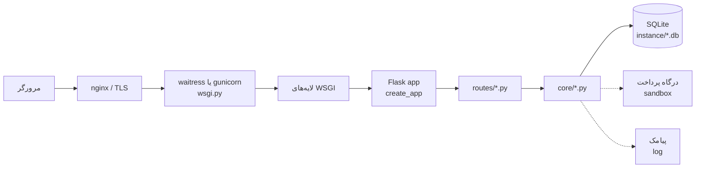
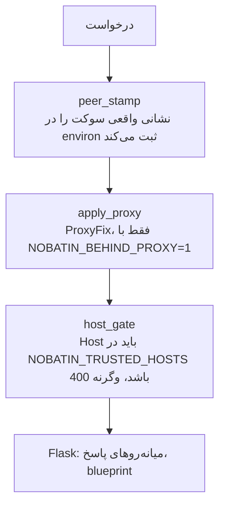
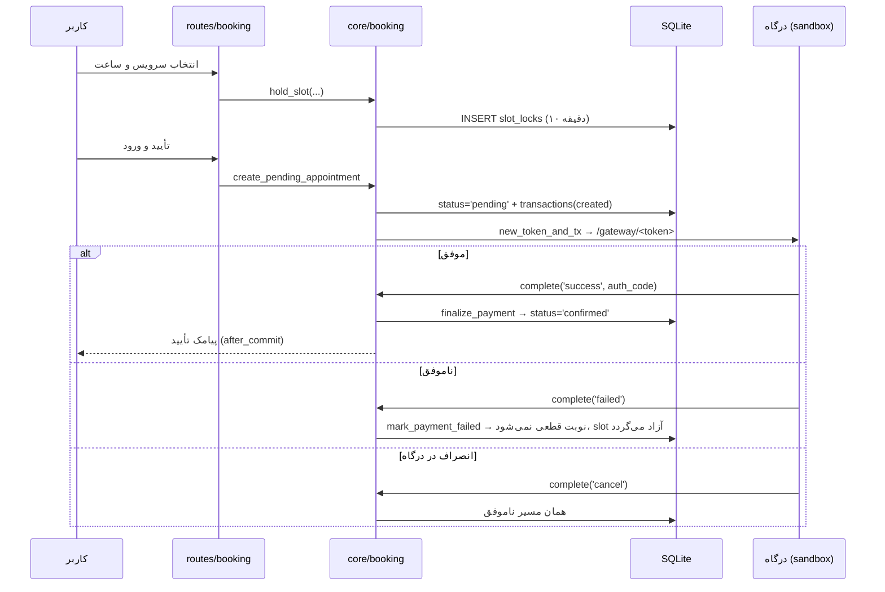
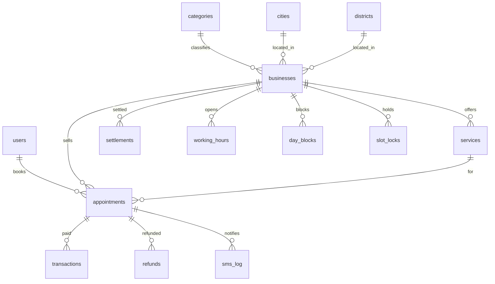

# معماری نوبتین

این سند لایه‌ها، مسیر پول و نقاط همزمانی را توضیح می‌دهد. کد مرجع است؛ اگر
اینجا و کد اختلاف داشتند، کد درست است و این فایل باید اصلاح شود.

## ۱) نگاه کلی

یک اپ Flask با کارخانهٔ `create_app()` و هفت blueprint. همه‌چیز روی یک پروسه
و یک فایل SQLite کار می‌کند؛ هیچ سرویس بیرونی (CDN، API، کش مرکزی) لازم نیست و
هیچ چیزی از شبکه بارگذاری نمی‌شود.

خط‌چین یعنی «وصل نشده، شبیه‌سازی است» — تنها دو نقطهٔ بیرونیِ پروژه.

## ۲) لایه‌های درخواست

ترتیب در `app.py` مهم است و عمداً این‌طور چیده شده:

* `peer_stamp` بیرونی‌ترین لایه است، چون `/healthz` و سقفِ نرخ باید IPِ واقعیِ
  سوکت را ببینند، نه `X-Forwarded-For` را که کاربر می‌تواند جعل کند.
* `ProxyFix` بعد از آن می‌آید و فقط وقتی روشن است که واقعاً پشتِ پروکسی باشیم.
* `host_gate` داخلی‌ترین است و پیش از ساخته‌شدنِ زمینهٔ درخواست کار می‌کند؛
  جعل هاست از راه `X-Forwarded-Host` هم `400` می‌گیرد.

میانه‌روهای سطحِ پاسخ (`after_request`) هدرهای امنیتی، `Server: nobatin`،
حذفِ `X-Powered-By` و در پنل‌ها `no-store` + `Vary: Cookie` را می‌گذارند.

## ۳) نقشهٔ ماژول‌ها

| ماژول | مسئولیت | وابستگی |
|---|---|---|
| `core/config.py` | خواندنِ متغیرهای محیطی و اعمالِ تنظیمات؛ تصمیمِ توسعه/production | — |
| `core/db.py` | ساختار جدول‌ها، مهاجرتِ افزوده‌شونده، تراکنش، کشِ کوئری، صفِ پیامک، پاک‌سازی | config |
| `core/jalali.py` | تقویم جلالی، اعداد فارسی، پول، تحلیل و ارزیابیِ سیاست انصراف | jdatetime |
| `core/booking.py` | slotها، قفلِ موقت، ساختِ نوبت، تأییدِ پرداخت، کنسلی و بازپرداخت، یادآوری، موجودی | db, jalali, gateway |
| `core/gateway.py` | درگاهِ شبیه‌سازی‌شده: توکن، صفحه، سه نتیجهٔ ممکن | db |
| `core/csrf.py` | توکن نشست‌محور و بررسیِ هر POST | — |
| `core/cache.py` | کشِ درون‌فرآیندی با بی‌اعتباریِ سطحِ جدول | db |
| `core/helpers.py` | `business_or_404`، نقش‌ها، رندرِ مشترک | db |
| `routes/*` | ورودی‌های HTTP: فقط پارامتر می‌گیرند، به `core` می‌سپارند و رندر می‌کنند | core |

قاعدهٔ لایه‌بندی: `routes` چیزی را ذخیره نمی‌کند مگر از راه `core`، و `core`
هیچ‌وقت `request` را نمی‌خواند (به‌جز `current_user_id()` که از نشست می‌خواند).

## ۴) جریان رزرو و پرداخت

سه ویژگی که در آزمون پوشش داده شده‌اند:

1. **پرداخت ناموفق هرگز نوبت قطعی نمی‌سازد.** تنها `finalize_payment` وضعیت را
   `confirmed` می‌کند و فقط از درگاه صدا زده می‌شود.
2. **رقابت روی یک ساعت:** ایندکسِ یکتای جزئی
   `ux_appt_slot_active ON appointments(business_id, date, start_hm) WHERE
   status IN ('pending','confirmed')` اجازه نمی‌دهد دو نوبتِ فعال روی یک ساعت
   بنشینند؛ `BEGIN IMMEDIATE` + `NOBATIN_TX_RETRIES` صفِ نوشتن را مدیریت می‌کند.
3. **قفلِ سبد** (`slot_locks`) ساعت را برای ۱۰ دقیقه رزرو می‌کند و `expire_locks`
   منقضی‌ها را آزاد می‌کند؛ نوبتِ `pending`ِ بی‌pay هم با
   `expire_pending_appointments` می‌میرد.

## ۵) مدل داده

جدول‌های پشتیبان: `settings` (کلید/مقدار، از جمله کارمزد)، `provinces`،
`cities`، `districts`، `otp_codes`، `audit_log` (ردپای عملیات مدیریتی) و
`rate_events` (سقف نرخِ DB-محور، بنابراین با چند پروسه هم درست کار می‌کند).

نکتهٔ طراحی: `appointments.cancel_policy` یک JSONِ فریزشده است. سیاستِ بعداً
تغییر‌یافتهٔ کسب‌وکار نباید نوبت‌های فروش‌رفته را جابه‌جا کند — همین دلیلِ
فریزکردن است.

## ۶) مالی

سه جدول جدا، تا هر مسیر قابل ردیابی بماند:

* `transactions` — هر پرداخت (`kind='payment'`) با وضعیت و کد پیگیری.
* `refunds` — هر بازپرداخت با درصدِ محاسبه‌شده از سیاست فریزشده و وضعیت
  `pending/approved/done`؛ بازپرداختِ خودکار فقط پس از تأییدِ مدیریت.
* `settlements` — تسویهٔ هر کسب‌وکار: فروش، بازپرداخت‌ها، کارمزد و ماندهٔ
  قابل پرداخت (`business_balance`).

مالیِ هر کسب‌وکار از مالیِ بقیه جداست: هر کوئریِ پنل با `business_id` مالک
مقیّد می‌شود و پنل مدیریت تنها نقطهٔ دیدِ سراسری است.

## ۷) پیامک

`core/db.py` یک صفِ `after_commit` دارد: تابعِ ارسال **پس از** commit موفق
ثبت می‌شود، تا پیامکی دربارهٔ نوبتی که commit نشده فرستاده نشود. گیرنده در
`sms_log` نوشته می‌شود و `reap_stuck_sms(minutes=15)` ردیف‌هایی را که میان
«ارسال‌شده‌است» و «تأییدشده» گیر کرده‌اند آزاد می‌کند. در `NOBATIN_ENV=production`
فقط لاگ می‌شود؛ در توسعه از `/sms-box` خوانده می‌شود و کد OTP در آنجا پیدا
می‌شود.

## ۸) کارایی

* کشِ درون‌فرآیندی (`core/cache.py`) برای دسته‌ها، استان‌ها/شهرها و آمارِ صفحهٔ
  خانه؛ بی‌اعتباری بر پایهٔ نامِ جدول است (`touch(table)`)، پس نوشتن در همان
  پروسه کش را بی‌اعتبار می‌کند و `settings` هم نوشتنش کش را می‌سوزاند.
* SQLite در حالت WAL با `busy_timeout=5000`، `synchronous=NORMAL` و mmap.
* هر صفحهٔ عمومی با یک درخواستِ کوئریِ گروهی ساخته می‌شود؛ N+1 در جست‌وجو و
  خانه با `slot_summary`/`COUNT` گروهی حذف شده است.
* `tools/bench.py` برای اندازه‌گیری؛ اعدادِ مرجع در `deploy/README.md`.

## ۹) بوتِ fail-closed در production

`create_app(env_name="production")` در این حالت‌ها **بالا نمی‌آید**:

* `NOBATIN_SECRET` نبود، کوتاه‌تر از ۳۲ نویسه بود، یا همان مقدارِ پیش‌فرضِ توسعه بود؛
* `NOBATIN_OTP_MASTER=1` (کد ثابتِ توسعه) روشن باشد؛
* `NOBATIN_TRUSTED_HOSTS` خالی باشد؛
* درگاه روی `sandbox` باشد بدون `NOBATIN_ALLOW_SANDBOX=1`.

منطق در `core/config.py: apply()` و `app.py` است؛ با `python app.py --selfcheck`
قابل مشاهده است.

## ۱۰) تست

`smoke_test.py` ۳۵ بخش دارد و پایگاه دادهٔ جدا و موقت می‌سازد؛ سرور لازم ندارد
(test client) و شبکه نمی‌زند. بخش‌های ۳۳ تا ۳۵ دقیقاً همان نقاطِ همزمانی،
پول و پروکسی را می‌سنجند که در بالا توضیح داده شد. CI همین فایل را روی پایتون ۳.۱۰ تا ۳.۱۳ اجرا می‌کند.
